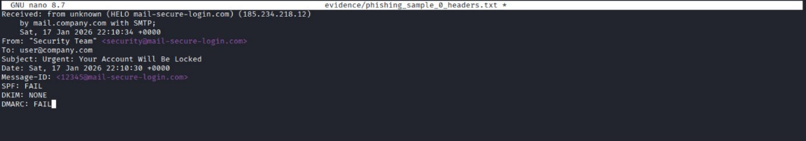

## Overview
Task 2 of my **Future Interns** internship focused on **phishing email detection** and **security awareness**.

📁 Repository: [FUTURE_CS_02](https://github.com/Razi-Ammari/FUTURE_CS_02)

## What I did
- Analysed a phishing email sample and its **raw headers**.
- Inspected **SPF, DKIM and DMARC** results to assess email authentication weaknesses.
- Identified phishing indicators: spoofed sender, mismatched `Reply-To`, suspicious links, urgency and social-engineering cues.
- Wrote **awareness guidelines** so non-technical users can recognise and report phishing.

*Raw email headers under analysis*

## Deliverable
A **Phishing Email Detection & Awareness Report (PDF)** plus header analysis notes, evidence and guidelines.
