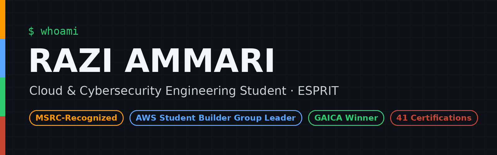

---
# The default layout is 'page'
icon: fas fa-info-circle
order: 4
---

  

# WHOAMI!

# I'm Razi Ammari

A dedicated and results-driven **Computer Engineering student** at **ESPRIT** (2024 – 2029), specializing in **cloud computing** and **cybersecurity**. I'm based in **Mahdia, Tunisia**, and my goal is clear: to become a **Cloud Security Engineer** who builds resilient, secure and future-ready multicloud environments.

On the security side, I'm an **MSRC-recognized security researcher** — the **Microsoft Security Response Center** acknowledged a vulnerability I discovered and responsibly disclosed in Microsoft Online Services. I've worked hands-on in a **SOC** at **BIAT**, building a detection & incident-response lab with **Splunk**, **Sysmon** and **MITRE ATT&CK**, and I've delivered consultant-grade **web, email and API security assessments** at **Future Interns**. On the governance side, I'm an **ISO/IEC 27001:2022 Lead Auditor**.

On the cloud side, I hold the **Oracle Cloud Infrastructure 2025 Networking Professional** and **Multicloud Architect Professional** certifications, IBM's **Cloud-Native & Multicloud Applications** certification, and I've trained deeply in **Kubernetes security (CKS)**, **Docker**, **Istio** and **Kubernetes Operators**. In total I hold **41 certifications** from Oracle, IBM, AWS, Fortinet, NVIDIA, MongoDB, TryHackMe and more.

Beyond security and cloud, I love building: I led team **Vision X** to **1st place at the GAICA AI Camera Challenge** with a real-time YOLOv8 + DeepSORT analytics system, and I've shipped projects in **agentic AI** (IBM watsonx Orchestrate), **blockchain** (Qubic), **secure web development** (PHP MVC) and **C++/Qt** desktop systems.

---

## Experience

| Role | Organization | Period |
|---|---|---|
| [Cyber Security Intern — SOC](/posts/Cyber-Security-Internship-BIAT-SOC-Lab/) | **BIAT** | Jun 2026 – Jul 2026 |
| [Cyber Security Intern — VA, Phishing & API Security](/posts/Future-Interns-Web-Vulnerability-Assessment/) | **Future Interns** (remote) | Jan 2026 |
| [Telecommunication & Networking Intern](/posts/Telecommunication-Networking-Internship-Tunisie-Telecom/) | **Tunisie Telecom** | Aug 2025 |
| [IT & Front-End Development Intern](/posts/IT-Front-End-Internship-Vitalait/) | **Vitalait Tunisie** | Jul 2025 |

## Education

**ESPRIT** — Ecole Supérieure Privée d'Ingénierie et de Technologies · *Computer Engineering* · 2024 – 2029

---

## Highlights

- 🛡️ **[Microsoft MSRC Security Researcher Acknowledgement](/posts/Microsoft-MSRC-Security-Researcher-Acknowledgement/)** — responsibly disclosed vulnerability in Microsoft Online Services.
- 🏆 **[1st Place — GAICA AI Camera Challenge](/posts/Vision-X-Winner-GAICA-AI-Camera-Challenge/)** with Vision X (team lead).
- ☁️ **[AWS Student Builder Group Leader](/posts/AWS-Student-Builder-Group-Leader-ESPRIT/)** — ESPRIT Monastir.
- ⛓️ **[Qubit-Forge-Quest](/posts/Qubit-Forge-Quest-Qubic-Hack-the-Future/)** — Qubic "Hack the Future" hackathon.

---

## Certifications (41)

### Cloud & Cloud-Native

| Certification | Issuer | Date |
|---|---|---|
| [OCI 2025 Certified Networking Professional](/posts/OCI-2025-Certified-Networking-Professional/) | Oracle | Oct 2025 |
| [OCI 2025 Certified Multicloud Architect Professional](/posts/OCI-2025-Certified-Multicloud-Architect-Professional/) | Oracle | Oct 2025 |
| [OCI 2025 Certified Foundations Associate](/posts/OCI-2025-Foundations-Associate/) | Oracle | Mar 2025 |
| [Building Cloud-Native and Multicloud Applications](/posts/IBM-Building-Cloud-Native-and-Multicloud-Applications/) | IBM | Sep 2025 |
| [Certified Kubernetes Security Specialist (CKS)](/posts/CKS-Certified-Kubernetes-Security-Specialist-KodeKloud/) | KodeKloud | Feb 2025 |
| [Linux Basics Course & Labs](/posts/CKS-Certified-Kubernetes-Security-Specialist-KodeKloud/) | KodeKloud | Feb 2025 |
| [Advanced Kubernetes Operators](/posts/IBM-Containers-Kubernetes-Istio-Track/) | IBM | Jun 2025 |
| [Intermediate Kubernetes Operators](/posts/IBM-Containers-Kubernetes-Istio-Track/) | IBM | Jun 2025 |
| [Containers, K8s and Istio on IBM Cloud](/posts/IBM-Containers-Kubernetes-Istio-Track/) | IBM | Jun 2025 |
| [Getting Started with Microservices with Istio and IBM Cloud Kubernetes Service](/posts/IBM-Containers-Kubernetes-Istio-Track/) | IBM | Jun 2025 |
| [Beyond the Basics: Istio and IBM Cloud Kubernetes Service](/posts/IBM-Containers-Kubernetes-Istio-Track/) | IBM | May 2025 |
| [Containers & Kubernetes Essentials](/posts/IBM-Containers-Kubernetes-Istio-Track/) | IBM | May 2025 |
| [Docker Essentials: A Developer Introduction](/posts/IBM-Containers-Kubernetes-Istio-Track/) | IBM | Mar 2025 |
| [AWS Cloud Quest: Cloud Practitioner](/posts/AWS-Cloud-Foundations/) | AWS | Mar 2025 |
| [AWS Educate Getting Started with Serverless](/posts/AWS-Cloud-Foundations/) | AWS | Mar 2025 |
| [AWS Knowledge: Cloud Essentials](/posts/AWS-Cloud-Foundations/) | AWS | Feb 2025 |
| [AWS Educate Introduction to Cloud 101](/posts/AWS-Cloud-Foundations/) | AWS | Feb 2025 |
| [Cloud Computing Fundamentals](/posts/IBM-Cloud-Computing-Fundamentals-Azure-DataCamp/) | IBM | Feb 2025 |
| [Microsoft Azure](/posts/IBM-Cloud-Computing-Fundamentals-Azure-DataCamp/) | DataCamp | Feb 2025 |

### Cybersecurity & GRC

| Certification | Issuer | Date |
|---|---|---|
| [SOC Level 1](/posts/TryHackMe-SOC-Level-1/) | TryHackMe | Jul 2026 |
| [Cyber Security 101](/posts/TryHackMe-Pre-Security-and-Cyber-Security-101/) | TryHackMe | Jul 2026 |
| [Pre Security](/posts/TryHackMe-Pre-Security-and-Cyber-Security-101/) | TryHackMe | Jul 2026 |
| [ISO/IEC 27001:2022 Lead Auditor](/posts/ISO-IEC-27001-2022-Lead-Auditor/) | Mastermind | Sep 2025 |
| [Quantum-Safe Encryption Essentials](/posts/IBM-Quantum-Safe-Encryption-Essentials/) | IBM | Aug 2025 |
| [Fortinet NSE 3 Certified in Cybersecurity](/posts/Fortinet-NSE-3-Certified-in-Cybersecurity/) | Fortinet | Jul 2025 |
| [Fortinet FortiGate 7.6 Operator](/posts/Fortinet-FortiGate-7-6-Operator/) | Fortinet | Jul 2025 |
| [Fortinet Certified Associate Cybersecurity](/posts/Fortinet-Certified-Associate-Cybersecurity/) | Fortinet | Jul 2025 |
| [Deloitte Australia – Cyber Job Simulation](/posts/Deloitte-Australia-Cyber-Job-Simulation/) | Deloitte | Jul 2025 |
| [Cybersecurity Fundamentals](/posts/Cisco-IBM-Cybersecurity-Foundations/) | IBM | Dec 2024 |
| [Introduction to Cybersecurity](/posts/Cisco-IBM-Cybersecurity-Foundations/) | Cisco | Dec 2024 |

### AI, Data & Development

| Certification | Issuer | Date |
|---|---|---|
| [MongoDB Atlas Administration](/posts/MongoDB-Atlas-Administration-and-Security/) | MongoDB | Dec 2025 |
| [MongoDB Atlas Security](/posts/MongoDB-Atlas-Administration-and-Security/) | MongoDB | Dec 2025 |
| [Building AI-Based Cybersecurity Pipelines](/posts/NVIDIA-Building-AI-Based-Cybersecurity-Pipelines/) | NVIDIA | Apr 2025 |
| [Applications of AI for Anomaly Detection](/posts/NVIDIA-Applications-of-AI-for-Anomaly-Detection/) | NVIDIA | Feb 2025 |
| [Fundamentals of Deep Learning](/posts/NVIDIA-Applications-of-AI-for-Anomaly-Detection/) | NVIDIA | Feb 2025 |
| [SQL Associate](/posts/SQL-Associate-DataCamp/) | DataCamp | Mar 2025 |
| [Foundational C# with Microsoft](/posts/Foundational-CSharp-Microsoft/) | Microsoft | Feb 2025 |
| [Scrum Foundation Learner](/posts/Scrum-Foundation-Certiprof/) | Certiprof | Dec 2024 |
| [Git and GitHub](/posts/Python-Git-Foundations-365DataScience/) | 365 Data Science | Nov 2024 |
| [Intermediate Python Programming](/posts/Python-Git-Foundations-365DataScience/) | 365 Data Science | Nov 2024 |
| [Introduction to Python](/posts/Python-Git-Foundations-365DataScience/) | 365 Data Science | Nov 2024 |

All credentials can be verified on my [LinkedIn profile](https://www.linkedin.com/in/razi-ammari-58a231335/details/certifications/).

---

## Skills

**Cloud:** OCI · AWS · Azure · IBM Cloud · multicloud architecture · VCN / FastConnect / DRG · serverless  
**Cloud-native:** Docker · Kubernetes · Kubernetes security (CKS) · Istio · Operators · Red Hat OpenShift  
**Security:** SOC operations · Splunk / SIEM · Sysmon · MITRE ATT&CK · incident response · vulnerability assessment · OWASP WSTG / API Top 10 · Nmap · OWASP ZAP · Postman · FortiGate · ISO 27001  
**AI:** YOLOv8 · DeepSORT · OpenCV · PyTorch · anomaly detection · agentic AI (IBM watsonx Orchestrate)  
**Development:** Python · C++ / Qt · C# · PHP 8 (MVC) · JavaScript / TypeScript · React · Node.js / Express · SQL · MySQL · Oracle DB · MongoDB  
**Networking & systems:** TCP/IP · VLAN · MPLS · ADSL/VDSL · Linux · Windows Server · Active Directory

---

## Community Involvement

As an **[AWS Student Builder Group Leader](/posts/AWS-Student-Builder-Group-Leader-ESPRIT/)**, I'm building the AWS student community at **ESPRIT Monastir** from the ground up: technical trainings, hands-on AWS labs, workshops and student-led projects connected to the global AWS Builder ecosystem.

---

## Contact

Feel free to connect with me on [LinkedIn](https://www.linkedin.com/in/razi-ammari-58a231335/) or explore my projects on [GitHub](https://github.com/Razi-Ammari).

I'm currently **open to Cloud Engineer and Cyber Security Engineer opportunities**.
