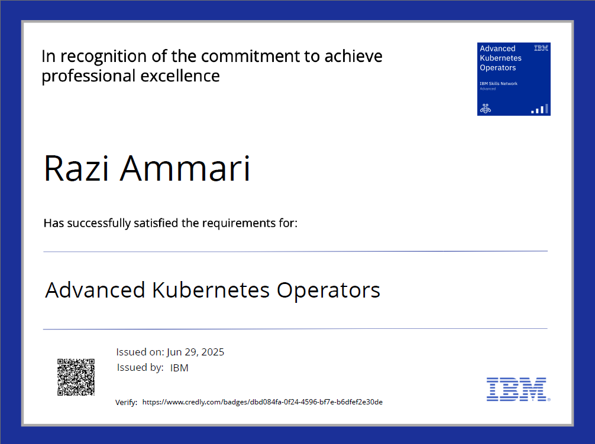
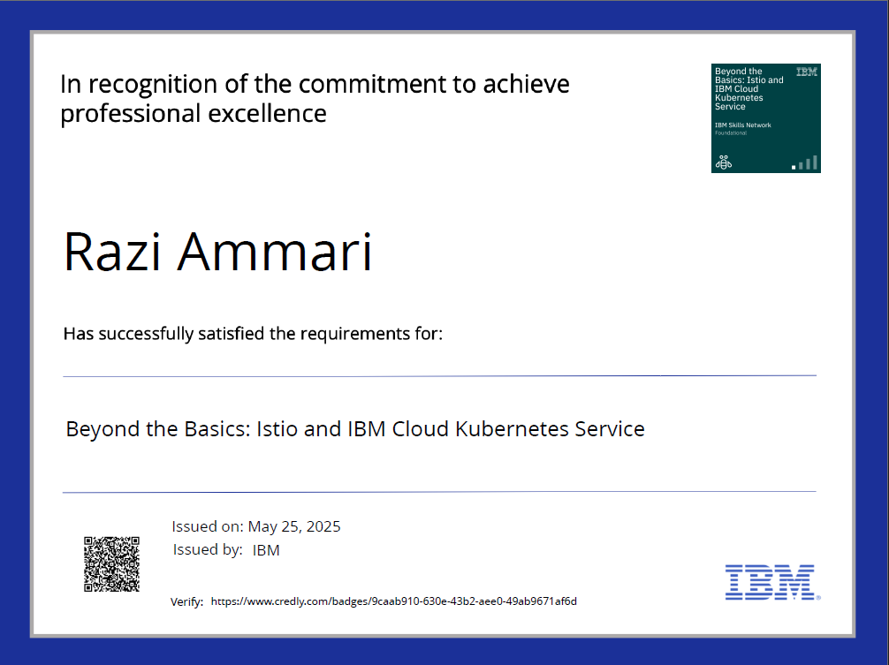
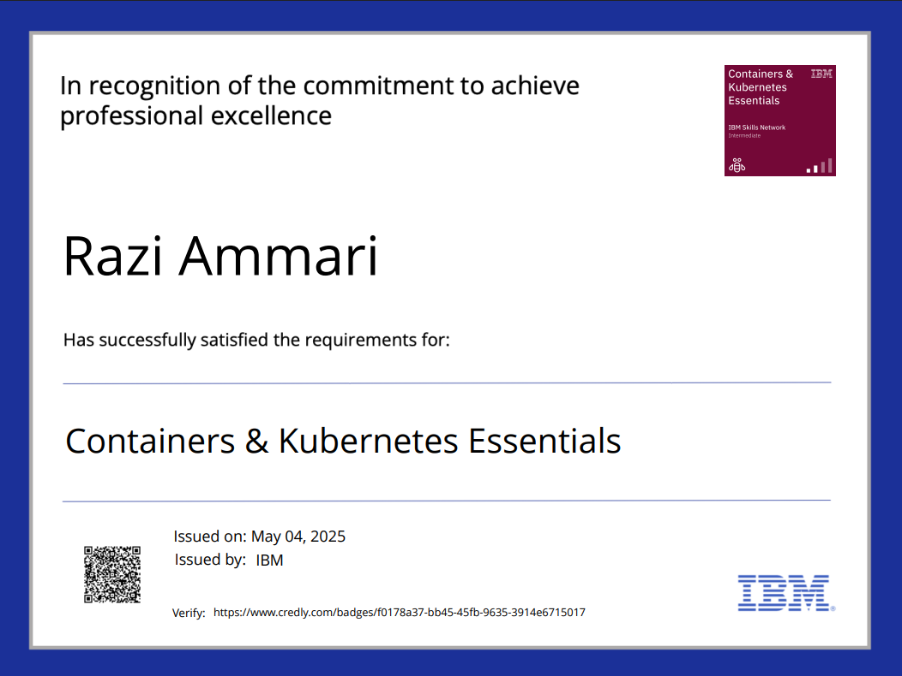
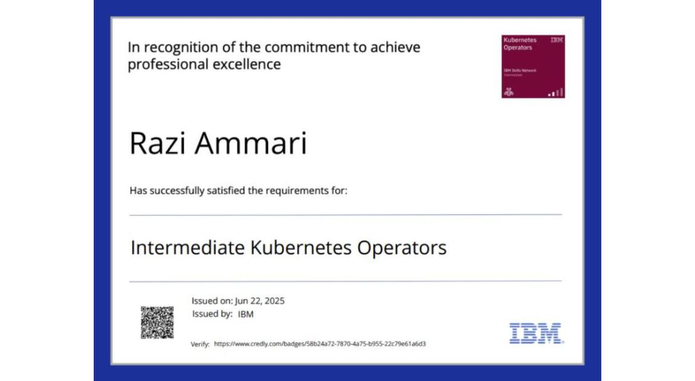
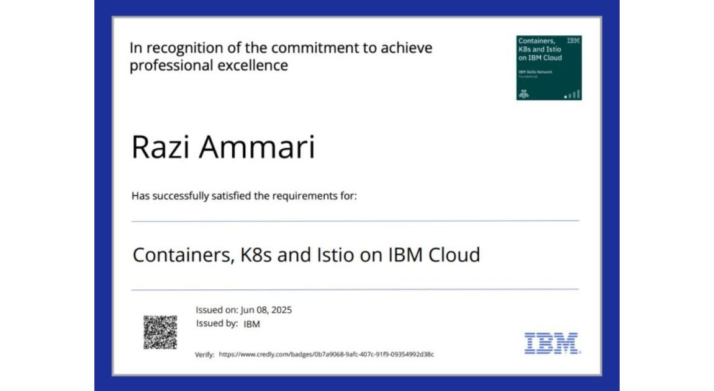
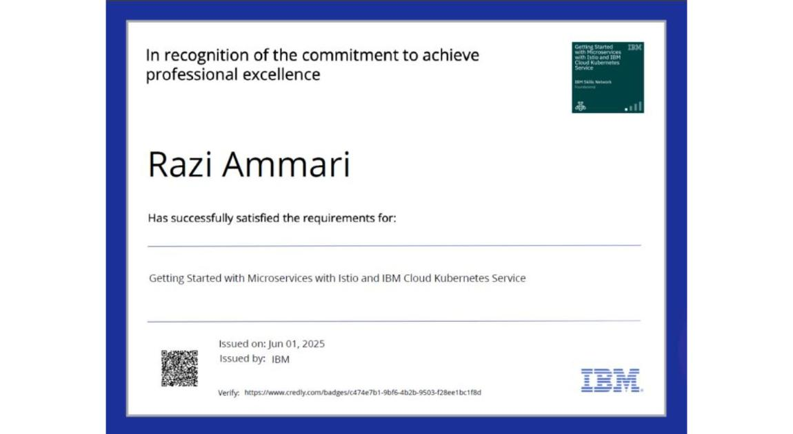

## Overview
From **March to June 2025** I completed IBM's full containers & Kubernetes learning track — **seven badges**:

| Badge | Issued |
|---|---|
| Docker Essentials: A Developer Introduction | Mar 2025 |
| Containers & Kubernetes Essentials | May 2025 |
| Beyond the Basics: Istio and IBM Cloud Kubernetes Service | May 2025 |
| Getting Started with Microservices with Istio and IBM Cloud Kubernetes Service | Jun 2025 |
| Containers, K8s and Istio on IBM Cloud | Jun 2025 |
| Intermediate Kubernetes Operators | Jun 2025 |
| Advanced Kubernetes Operators | Jun 2025 |

## Key Takeaways
- **Docker**: images, layers, registries and multi-container apps.
- **Kubernetes**: pods, deployments, services, ingress, scaling and rolling updates.
- **Istio service mesh**: traffic management, mTLS between services, observability and resilience.
- **Kubernetes Operators**: custom resources (CRDs), reconciliation loops and building operators with the Operator SDK.

Combined with **CKS**, this gives me both the *build* and the *secure* side of cloud-native platforms.

## Verification
The credential can be verified from my [LinkedIn certifications](https://www.linkedin.com/in/razi-ammari-58a231335/details/certifications/) page ("Show credential").

## Certificates

