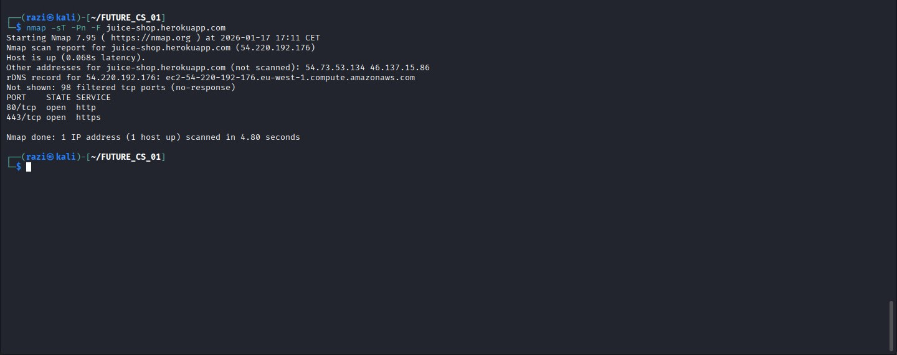
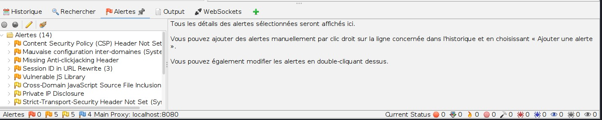

## Overview
In **January 2026** I joined **Future Interns** as a remote **Cyber Security Intern**. Task 1 was a professional, **read-only Vulnerability Assessment** of a public web application — **OWASP Juice Shop** (demo app).

📁 Repository: [FUTURE_CS_01](https://github.com/Razi-Ammari/FUTURE_CS_01)

## Scope & Ethics
Passive analysis only: no exploitation, no authentication bypass, no brute force, no DoS. This simulates a **security audit**, not a penetration test.

## Methodology (aligned with OWASP WSTG)
- **Nmap** for basic port & exposure analysis.
- **OWASP ZAP** passive scan to collect alerts.
- **Browser DevTools** and `curl` to review headers, cookies and client-side code.

*Exposure analysis with Nmap*

*Passive scan alerts in OWASP ZAP*

## Findings
- Exposed services and information disclosure risks.
- Missing / misconfigured **security headers** (CSP, HSTS, X-Frame-Options…).
- Findings classified by severity (**Low / Medium / High**) with business impact and remediation guidance.

## Deliverable
A consultant-grade **Vulnerability Assessment Report (PDF)** with evidence and screenshots.
