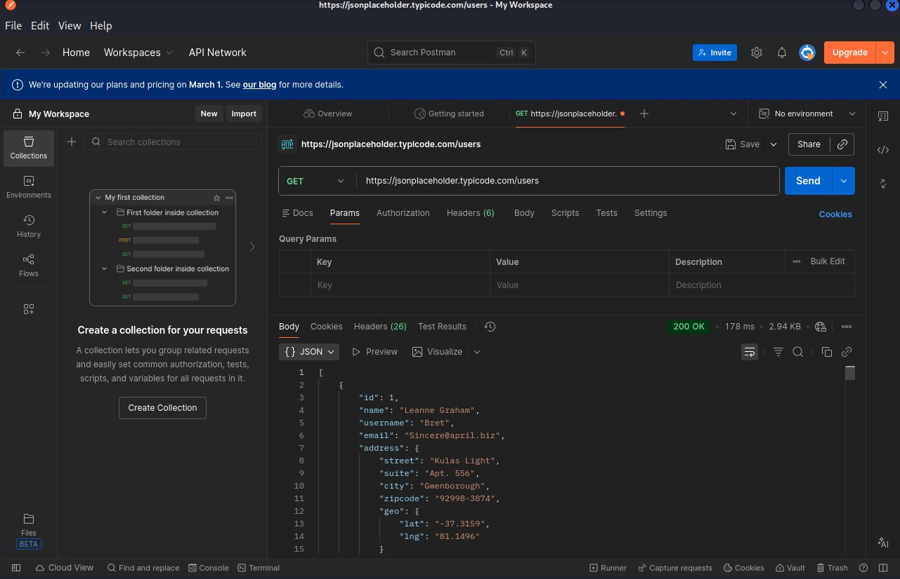

## Overview
Task 3 was a professional, read-only **API Security Risk Analysis** of a public demo API — **JSONPlaceholder** (`GET /users`).

📁 Repository: [FUTURE_CS_03](https://github.com/Razi-Ammari/FUTURE_CS_03)

## Methodology
- **Postman** for request testing & response inspection.
- **Browser DevTools** for header and request analysis.
- Mapping every finding to the **OWASP API Security Top 10**.

*Inspecting the /users endpoint in Postman*

## Key Findings
1. **Open / unauthenticated endpoint** — *High*: no API key, token or user validation.
2. **Excessive data exposure** — *High*: full user profiles returned, including emails and phone numbers.
3. **Missing rate limiting** — enables large-scale scraping.
4. **Authorization concerns** — no object-level access control (BOLA risk).

Each risk was translated into **business impact** (privacy incidents, data scraping, service abuse) with practical remediation: authentication, field-level filtering, rate limiting and object-level authorization.
